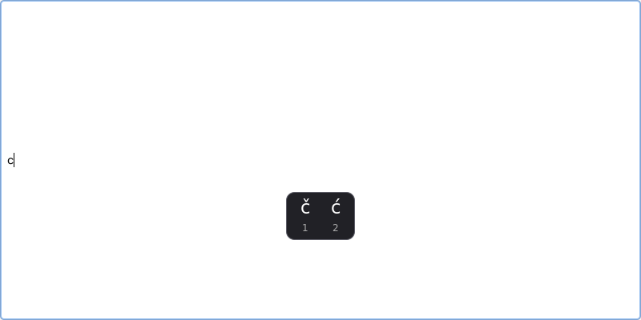

# hacek

Hold a letter, get its accented variants: the macOS press-and-hold accent menu, for Wayland.

Named after the *háček*, the little hook on č, š and ž.

- Hold `c`, press `2`, get `ć`. Capitals work the same.
- Opens only on letters that have variants in your keyboard layouts. Other keys repeat as usual.
- Left/Right and Enter or Space also pick; Escape closes; any other key closes and types.
- Never opens in fields marked as passwords.
- No root, no `input` group. It is an ordinary Wayland input method, gets keys only while a
  text field is focused, stores nothing and has no network code.

## Install

From source (needs Rust, Pango, Cairo and libxkbcommon):

    cargo install --path .

Arch Linux: download the `.pkg.tar.zst` from
[Releases](https://github.com/adamgiacomelli/hacek/releases), then

    sudo pacman -U ./hacek-*.pkg.tar.zst

or build it with `cd packaging/arch && makepkg -si`.

Ubuntu 24.04 and later: download the `.deb` from
[Releases](https://github.com/adamgiacomelli/hacek/releases), then

    sudo apt install ./hacek_*.deb

## Use

    hacek --layout si

In Sway's config (after `cargo install`, use the full path if Sway's PATH lacks `~/.cargo/bin`):

    exec hacek --layout si

Layouts set up in the compositor are always included, so with `xkb_layout us,si` plain `hacek`
is enough. `--layout` adds layouts you do not otherwise use, `--extra e=éè` adds single letters,
and `--list` shows what the options give you. See `hacek --help`.

Letters behind AltGr count only for layouts with no accents on plain keys (Polish, US-intl).
`--altgr` includes them always. Accents typed with dead keys (é on Spanish) are not detected;
use `--extra`.

## Where it works

The compositor must offer input-method-v2, virtual-keyboard-v1 and layer-shell. Tested on
Sway 1.12; other wlroots-style compositors may work. GNOME and KDE do not offer these.

Tested in foot, Alacritty, GTK 4, Qt 6 and Chrome. Applications need Wayland text input, so
XWayland applications do not get the menu. Neither did a GTK popover in our tests.

It cannot run next to fcitx5 or ibus, as a seat has one input method.

In terminals, letters with variants do not repeat when held, also not in vim.

`--position` puts the menu at the `bottom` (default), `center` or `top` of the screen, or at the
`caret`: under the letter, or over it when there is no room. Fields that do not say where their
cursor is, like Chrome's address bar, get it at the bottom of the screen instead. `caret` is experimental. Bugs in
Sway's input popups ([#9343](https://github.com/swaywm/sway/issues/9343),
[#8541](https://github.com/swaywm/sway/issues/8541)) crash Sway 1.12, and your session with it, for
instance when a GTK or Qt window closes while the menu is open.

## Develop

    cargo test                             # state machine, variants, command line
    cargo test --test e2e -- --ignored     # real applications

The second runs hacek in a private headless Sway with a fake keyboard, away from your session.
It needs Sway, foot and PySide6.

MIT licensed.
